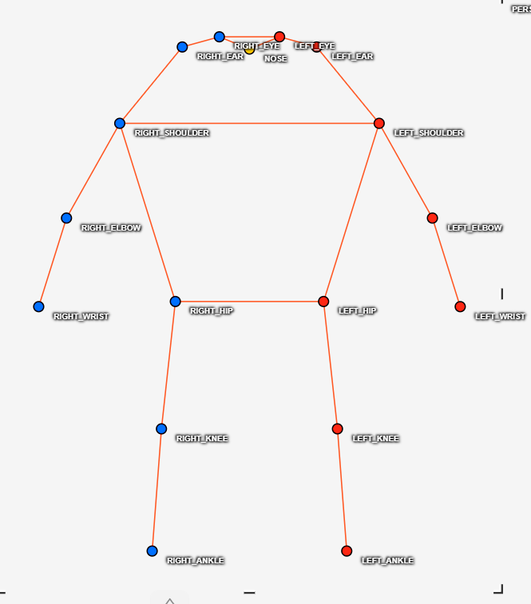
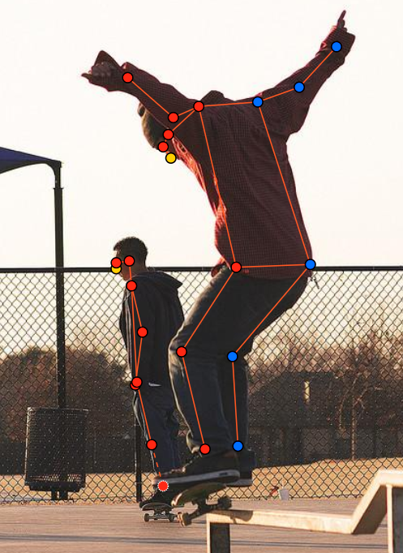
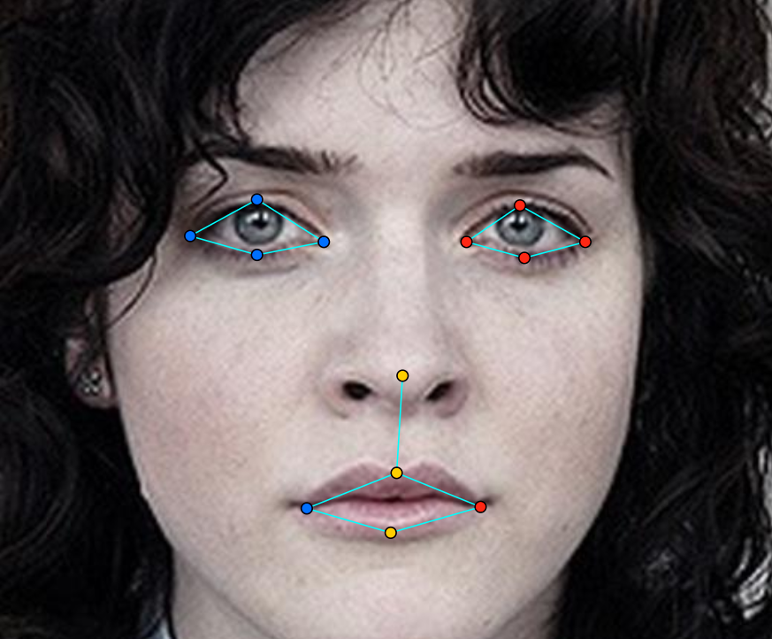
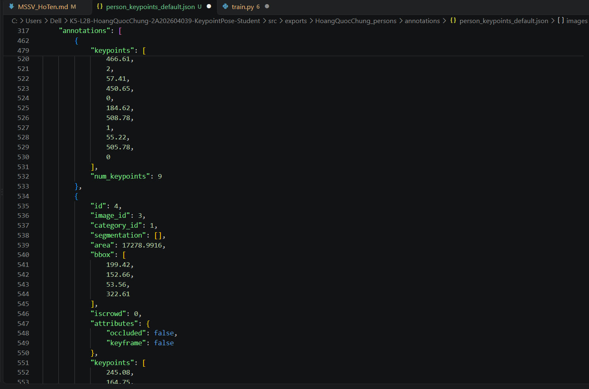

# Báo cáo cá nhân — HoVaTen-MSSV

Đổi tên file theo quy tắc `MSSV_HoTen.md`. Ví dụ: `20241234_NguyenVanAn.md`.

Dữ liệu: 12 ảnh người COCO val2017 (Lin et al., 2014) và 8 ảnh chân dung Wikimedia Commons, chỉ dùng trong lớp.

## 0. Thông tin học viên

- Họ tên: Hoàng Quốc Chung
- MSSV: 2A202604039
- Email: 26ai.chunghq2@vinuni.edu.vn
- Link repository: https://github.com/VinUni-AI20k/K5-L2-KeypointPose-Student
- Phiên bản CVAT (Help → About): 2.74.1
- Máy: hệ điều hành Win 11 · RAM 16 GB · chạy CVAT chế độ đầy đủ 
- Bộ ảnh (`src/exports/assignment.json` do `lab.py setup` tạo): có 
- Giờ bắt đầu: 17h00
- Giờ kết thúc: 19h00

## 1. Kiểm tra label (CP0)

| Label | Kiểu | Số điểm | Tên điểm đúng bảng của lab? | Đúng thứ tự? | Số cạnh |
|---|---|---:|---|---|---:|
| `person` | Skeleton | 17 | Có | Có | 19 |
| `face` | Skeleton | 13 | Có | Có | 12 |

Mẫu `person` dựng theo người quay mặt về camera (các điểm `left_*` nằm bên phải khung mẫu)? Có 

Cách đổi cờ `occluded` / `outside` cho **một điểm** trên phiên bản CVAT này (một câu):
Nhấp chuột phải trực tiếp vào điểm cần đổi trên ảnh (hoặc mở rộng mục `[PARTS]` trong bảng Objects bên phải) rồi chọn **Switch occluded property** (phím tắt `Q` / `/`) để bật `v = 1` hoặc **Switch outside property** để bật `v = 0`.

## 2. Số lượng đã gán và thời gian (CP1, CP2)

| Nhóm ảnh | Số ảnh | Số skeleton đã gán | Số người dưới 60 px (không gán) | Số poster / gương / màn hình bỏ qua | Thời gian (phút) |
|---|---:|---:|---:|---:|---:|
| `easy` | 5 | 6 | 0 | 0 | 20 |
| `occluded` | 3 | 6 | 1 | 0 | 20 |
| `back` | 2 | 4 | 0 | 0 | 15 |
| `small` | 1 | 2 | 2 | 0 | 10 |
| `crowd` | 1 | 2 | 5 | 0 | 15 |
| `faces` | 8 | 8 | — | 0 | 25 |

- Số ảnh người đã xong ở mốc phút 105: 10 / 10
- Thời gian thực tế (phút): CP1 80 · CP2 25 · CP3 15
- Ảnh tốn thời gian nhất là ảnh nào, vì sao?
   Ảnh tốn thời gian nhất là ảnh đám đông `000000572411.jpg`, vì trong khung hình có nhiều người đứng gần nhau và bị vật cản che khuất một phần cơ thể; ngoài việc phải đo chiều cao từng người để loại bỏ các đối tượng dưới 60 px, ta còn phải xác định chính xác tư thế khoanh tay bắt chéo và phân biệt rạch ròi giữa điểm bị che ước lượng được với điểm bị che kín hoàn toàn.

## 3. Bảng ca khó (CP1, CP2)

Mỗi điểm bạn phân vân một dòng, nhất là phân vân giữa `v = 1` và `v = 0`, hoặc không chắc hướng người.

| Ảnh | Người / mặt | Điểm | Cờ đã chọn | Phân vân giữa | Lý do chọn |
|---|---|---|---:|---|---|
| `000000375535.jpg` | Người #1 (cảnh sát mô tô bên phải) | `right_hip`, `left_hip` | 1 | `v = 1` và `v = 0` | Phần hông bị đầu xe mô tô che khuất hoàn toàn, nhưng nhìn thấy rõ hai vai phía trên và hai đầu gối, cổ chân lộ ra ở hai bên thân xe nên ước lượng chắc chắn được trục khớp hông. |
| `face_256814.jpg` | Mặt #1 (nam đeo kính râm) | `right_eye_*`, `left_eye_*` (8 điểm mắt) | 1 | `v = 1` và `v = 0` | Khuôn mặt hơi nhòe và đeo kính râm đen che kín hoàn toàn hai mắt, nhưng dựa vào gọng kính, sống mũi và độ nghiêng của đầu vẫn ước lượng chắc chắn được vị trí giải phẫu của hai hốc mắt nên chọn `occluded`. |
| | | | | | |

## 4. Bảng tự review (CP3)

Đi từ ảnh cuối về ảnh đầu. 5 ảnh người (ít nhất 2 ảnh `back` hoặc `crowd`) và 3 ảnh mặt. Ít nhất 8 dòng, kể cả dòng `ok`. Ghi lỗi trước, sửa sau.

Mã lỗi dùng đúng một trong: `lr_swap`, `vis_flag`, `position`, `missing`, `extra`, `ok`.

| Ảnh | Người / mặt | Điểm | Mã lỗi | Ghi chú | Đã sửa? |
|---|---|---|---|---|---|
| `face_256814.jpg` | Mặt #1 (nam đeo kính râm) | `right_eye_*`, `left_eye_*` (8 điểm mắt) | 1 | `v = 1` và `v = 0` | Khuôn mặt hơi nhòe và đeo kính râm tối màu che kín hoàn toàn hai mắt, nhưng dựa vào gọng kính, sống mũi và độ nghiêng đầu vẫn ước lượng chắc chắn được vị trí giải phẫu hai mắt nên chọn `occluded` (`v = 1`). |
| `face_476363.jpg` | Mặt #1 (người gọi điện thoại) | `right_eye_outer`, `mouth_right` | 1 | `v = 1` và `v = 0` | Góc chụp nghiêng khiến đuôi mắt phải khuất nhẹ sau sống mũi và khóe miệng phải bị bàn tay cầm điện thoại che một phần, nhưng vẫn nằm trên trục đối xứng khuôn mặt nên đặt `v = 1`. |
| `face_505385.jpg` | Mặt #1 (nam quay nghiêng) | `right_eye_outer` | 1 | `v = 1` và `v = 0` | Đầu quay nghiêng sang bên phải ảnh làm sống mũi che lấp phần đuôi mắt phải, tuy nhiên vẫn thấy rõ nhãn cầu và mí mắt phải nên ước lượng được vị trí đuôi mắt (`v = 1`). |
`000000515309.jpg` | Người #1 (tay đua mô tô nghiêng xe) | `nose`, `left_eye`, `right_eye` | 0 | `v = 1` và `v = 0` | Tay đua quay lưng ôm cua gắt, đội mũ bảo hiểm kín đầu nên toàn bộ khuôn mặt bị khuất hoàn toàn phía trước, không đủ căn cứ định vị từng điểm mắt/mũi nên đặt `outside` (`v = 0`). |
| `000000515309.jpg` | Người #1 (tay đua mô tô nghiêng xe) | `left_elbow`, `left_wrist` | 0 | `v = 1` và `v = 0` | Tay trái của tay đua bị thân xe mô tô và cánh tay phải che khuất hoàn toàn ở phía trước tay lái nên đặt `outside` (`v = 0`) để tránh đoán bừa. |
| `000000480582.jpg` | Người #2 (người đàn ông quay lưng bên trái) | `left_ankle` | 0 | `v = 1` và `v = 0` | Chân trái bị con cừu đứng phía sau che kín hoàn toàn từ đầu gối xuống bàn chân, không lộ giày hay biên chân nên không thể ước lượng vị trí cổ chân (`v = 0`). |
| `000000413160.jpg` | Người #1 (cảnh sát mô tô bên phải) | `right_hip`, `left_hip` | 1 | `v = 1` và `v = 0` | Phần hông bị đầu xe mô tô che khuất, nhưng thấy rõ hai vai phía trên và hai đầu gối/cổ chân lộ ở hai bên sườn xe nên ước lượng chắc chắn được trục khớp hông (`v = 1`). |
| `000000413160.jpg` | Người #2 (cảnh sát mô tô ở giữa) | `left_hip`, `right_knee`, `left_ankle` | 0 | `v = 1` và `v = 0` | Toàn bộ nửa thân dưới của cảnh sát ngồi ở giữa bị đầu xe mô tô phía trước và thùng xe chắn kín hoàn toàn, không có điểm tựa giải phẫu nên chọn `outside` (`v = 0`). |

Tổng hợp số lỗi theo mã:

| `lr_swap` | `vis_flag` | `position` | `missing` | `extra` | `ok` |
|---:|---:|---:|---:|---:|---:|
| 1 | 2 | 1 | 0 | 1 | 5 |

Điểm còn phân vân giữa `v = 1` và `v = 0` (ghi cả hai lựa chọn và lý do chọn):

Tại ảnh `000000480582.jpg` (người đàn ông quay lưng bên trái), điểm `left_knee` bị con cừu đứng phía sau che lấp hoàn toàn. Nếu chọn `v = 0` thì tuân thủ nguyên tắc an toàn tuyệt đối khi bị vật thể khác che toàn bộ chân dưới; tuy nhiên, vì vẫn nhìn thấy rõ hông trái phía trên, tư thế đứng thẳng tự nhiên của người đàn ông và vị trí đầu gối phải ngay bên cạnh nên em chọn `v = 1` để ước lượng trục đùi trái, trong khi điểm `left_ankle` phía dưới không có điểm tựa nào thì chuyển sang `v = 0`.

## 5. Kiểm file xuất và kết quả tự kiểm (CP4)

Tự kiểm tay trong file JSON:

| File | Người / mặt kiểm (ảnh, thứ tự) | Số phần tử `keypoints` | Điểm `outside` ra `v = 0`, `occluded` ra `v = 1`? | `num_keypoints` khớp? |
|---|---|---:|---|---|
| `HoangQuocChung_persons.zip` | `000000480582.jpg`, người #1 | 51 | Có | Có |
| `HoangQuocChung_persons.zip` | `000000515309.jpg`, người #1 | 51 | Có | Có |
| `HoangQuocChung_faces.zip` | `face_256814.jpg`, mặt #1 | 39 | Có | Có |

Sau khi xuất, CVAT ghi `occluded` thành `v = 1` và `outside` thành `v = 0`. Tọa độ của điểm `outside` trong file là `0, 0` hay tọa độ cũ? Toạ độ cũ

Hai job đã chuyển sang completed trên CVAT? Có

Dán phần **TÓM TẮT** in ra từ `src/check_submission.py`:

- File person: HoangQuocChung_persons.zip
  Số ảnh: 12 · số skeleton `person`: 20 · mỗi annotation 51 số
  Skeleton theo ảnh: 000000103970=1, 000000156986=2, 000000162046=1, 000000177338=2, 000000375535=3, 000000413160=3, 000000445187=1, 000000463932=1, 000000480582=2, 000000515309=1, 000000525227=1, 000000572411=2
  Cờ v: v=2 208 (61%) · v=1 39 (11%) · v=0 93 (27%)
  num_keypoints trung bình: 12.3
- File face: HoangQuocChung_faces.zip
  Số ảnh: 8 · số skeleton `face`: 8 · mỗi annotation 39 số
  Skeleton theo ảnh: face_10579=1, face_178208=1, face_256814=1, face_257657=1, face_362568=1, face_476363=1, face_505385=1, face_562485=1
  Cờ v: v=2 93 (89%) · v=1 11 (11%) · v=0 0 (0%)
  num_keypoints trung bình: 13.0
- Ghi chú: 93 điểm v = 0 vẫn mang tọa độ cũ (CVAT 2.x xuất như vậy; chuẩn COCO ghi 0, 0). Không phải lỗi: điểm v = 0 bị bỏ qua khi huấn luyện và khi chấm.
- Số [LỖI]: 0 · số [CẢNH BÁO]: 1
Kết quả: ĐẠT (đọc lại từng cảnh báo ở trên)

## 6. Ảnh chụp màn hình

1. Label `person` trong label constructor (đủ 17 điểm có tên):

   

2. Một người quay lưng đã gán, cờ đã đặt:

   

3. Một khuôn mặt đã gán 13 điểm, phóng to vùng mắt:

   

4. Một đoạn JSON xuất của một người:

   

Nguồn ảnh: COCO val2017 / Wikimedia Commons.

## 7. Tự đánh giá

1. Lỗi bạn mắc nhiều nhất hôm nay, và cách bạn sẽ tránh ở dự án thật:

   Lỗi mắc nhiều nhất hôm nay là nhầm lẫn giữa hai cờ che khuất (`occluded` `v = 1` và `outside` `v = 0`) cùng lỗi gán thừa (`extra`) các đối tượng đứng ở xa có chiều cao dưới 60 px trong ảnh đám đông. Ở dự án thật, em sẽ dùng công cụ đo kích thước tối thiểu trước khi chấm để loại bỏ ngay đối tượng không đạt chuẩn, đồng thời tuân thủ nghiêm nguyên tắc "không đoán bừa": chỉ bật `v = 1` khi nhìn thấy rõ hai khớp lân cận để suy ra trục xương, còn cụm khớp bị che kín hoàn toàn từ gốc đến ngọn thì đặt `v = 0` ngay từ đầu.

2. Một quy tắc bạn đề xuất thêm vào guideline (kèm ảnh ví dụ nếu có):

  Đề xuất bổ sung quy tắc rõ ràng cho **tư thế khoanh tay hoặc đan chéo chi trước cơ thể**: khi người được gán nhãn khoanh tay (như nhân vật #1 trong ảnh `000000572411.jpg`), bắt buộc phải truy vết liên tục từ vai $\rightarrow$ khuỷu tay $\rightarrow$ cổ tay theo đúng giải phẫu thay vì mặc định chấm bên trái ảnh là `right_wrist` và bên phải ảnh là `left_wrist`, đồng thời ghi chú rõ trường hợp này để không bị nhầm với lỗi `lr_swap` khi chạy script kiểm tra tự động.

3. Nhãn của bạn đi vào model ở đâu? Chọn một lỗi bạn đã sửa và nói nó sẽ làm model học sai thế nào (heatmap, trọng số trong loss, hay bước lật ảnh):

   Trong quá trình huấn luyện mô hình ước lượng tư thế (như HRNet hay ViTPose), tọa độ keypoint được chuyển thành **heatmap phân phối chuẩn 2D (Gaussian)** làm nhãn mục tiêu, cờ `v` quyết định **trọng số trong hàm loss** ($v = 0$ bị nhân trọng số $0$ để bỏ qua khi tính loss), và bộ dữ liệu sẽ đi qua bước **tăng cường dữ liệu lật ngang ảnh (horizontal flip)** kèm hoán đổi cặp chỉ số `left_*` $\leftrightarrow$ `right_*`. Nếu không sửa lỗi `lr_swap` ở cặp hông (`left_hip`, `right_hip`) trên ảnh `000000480582.jpg`, mô hình sẽ bị ép học tín hiệu mâu thuẫn: heatmap hông trái lại xuất hiện ở nửa thân phải và khi lật ngang ảnh thì nhãn lại đảo ngược sai lệch hoàn toàn, làm mô hình hội tụ kém và dễ đoán nhầm trái/phải ở các tư thế đứng nghiêng hoặc quay lưng.

## 8. Khó khăn và lỗi kỹ thuật

   Khó khăn về thao tác trên CVAT: Khung skeleton mẫu ban đầu có 17 điểm nằm sát nhau nên khi gán người quay nghiêng hoặc quay lưng dễ bị rối dây nối.

## Bonus (nếu làm)

### B1 — 3 ảnh người khó thêm

| Ảnh | Số skeleton | Số người dưới 60 px | Ca khó nhất |
|---|---:|---:|---|
| | | | |
| | | | |
| | | | |

Kết quả `src/check_submission.py` cho `HoVaTen_bonus_persons.zip`:

```text
(dán ở đây)
```

### B2 — 5 ảnh khuôn mặt đen trắng / hồng ngoại

Ảnh không màu khó hơn ở điểm nào? Kính râm trên ảnh hồng ngoại có còn là `v = 1` không?

...

### B3 — Model so với nhãn của tôi (không tính điểm)

- Demo đã dùng:
- Ảnh đã thử:

1. Model có trả điểm cho khớp bị che, hay khớp ngoài ảnh không? Confidence ở các điểm đó thế nào?

   ...

2. Với người quay lưng, model có đổi trái/phải không?

   ...

3. Bộ điểm của model có giống 17 điểm COCO không?

   ...

## 9. Tài liệu tham khảo và công cụ AI đã dùng

...
